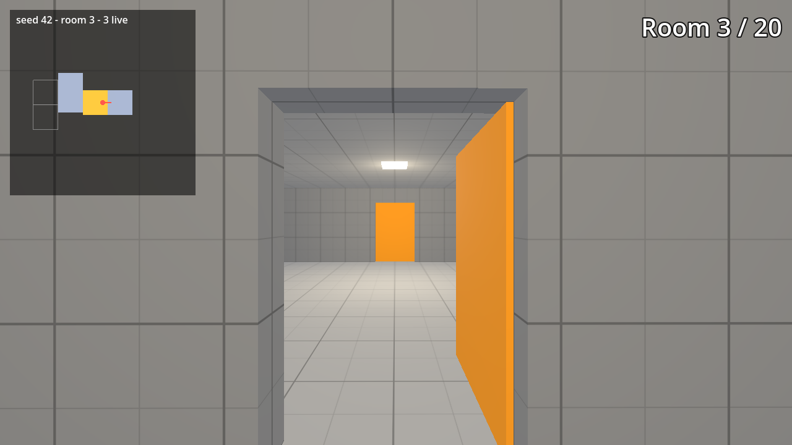

# A Run to Finish in Godot 4

Project files for tutorial 03 of the Godot 4 series by Phaix on YouTube (https://www.youtube.com/@Phaix).

Turn an endless chain of generated rooms into a game in Godot 4: a room counter, a goal room the generator always places, game states, a run timer from physics time, a clean restart and a best time per seed saved as JSON that always loads. Every step is its own project folder.



## Steps

Every step of the video is its own folder in `steps/`, the exact state at the end of that
part. Open the project in Godot 4.7, then open `steps/<step>/main.tscn` and press F6 to run
that step. The project's main scene is the final step.

| Folder | Part of the video |
|---|---|
| `steps/step_00_start` | Starting point (the final state of the previous tutorial) |
| `steps/step_01_room_counter` | Step 1 - A room counter |
| `steps/step_02_goal_room` | Step 2 - The goal room |
| `steps/step_03_game_states` | Step 3 - Game states |
| `steps/step_04_run_timer` | Step 4 - A run timer |
| `steps/step_05_restart` | Step 5 - Restart |
| `steps/step_06_best_time` | Step 6 - A best time |

## Controls

WASD or arrow keys or the left stick to walk, mouse or right stick to look, Space to jump,
Esc gives the mouse back, a click captures it again. Further keys per tutorial are shown
in the video and in the HUD.

## Tests

```sh
godot --headless --path . -s res://tests/run_tests.gd
```

## License

Code and scenes: MIT (see LICENSE).
